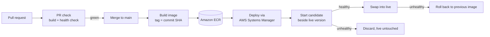

# SRE Learning Lab

A real, working AWS environment I built and operate to learn Site Reliability Engineering hands-on. Everything is defined as code, deployed automatically, and has broken for real at least once. Each fix is documented.

**Stack:** AWS (VPC, EC2, ALB, Route 53, ACM, IAM, ECR, SSM, S3, DynamoDB) · Terraform · Ansible · Docker · GitHub Actions · Kubernetes (k3s) · Bash

---

## What it does

A code change goes from a pull request to production with no manual steps, no SSH, and no stored AWS keys:



Visitors reach the site over HTTPS through an Application Load Balancer, which only sends traffic to healthy targets.

---

## What I built

| Area | What is in this repo |
|---|---|
| **Infrastructure as code** | `terraform/`: VPC across two Availability Zones, public and private subnets, EC2, Application Load Balancer with HTTP→HTTPS redirect, Route 53 DNS, ACM certificate with DNS validation, ECR repository. Remote state in S3 with DynamoDB locking. |
| **Security** | Security groups hardened on least privilege (SSH and HTTPS limited to one IP; app ports only from the ALB). IAM roles instead of access keys: the server pulls from ECR with an instance role; the pipeline authenticates with **GitHub OIDC** (short-lived credentials, trust limited to this repository) and may run commands on one named instance only. |
| **Configuration management** | `ansible/`: playbooks organised into reusable roles (nginx, docker), Jinja2 templates, idempotency verified with before/after runs. |
| **Containers** | `docker/`: custom nginx image, stored in private ECR, served by the ALB from a container on port 8080. |
| **CI/CD** | `.github/workflows/pr-check.yml` builds and health-checks the image on every pull request. `.github/workflows/build-and-push.yml` builds, tags with the commit SHA, pushes to ECR and deploys on every merge. Path filters skip unnecessary runs; a concurrency lock prevents overlapping deploys. |
| **Safe deployment** | `deploy/deploy.sh`: starts the new container on a spare port, health-checks it with retries, swaps it in, and rolls back automatically if the new version fails. |
| **Kubernetes** | A separate k3s node provisioned with Terraform. Multi-replica deployment, self-healing verified by deleting pods and watching the control plane rebuild them. |

---

## Real problems I diagnosed and fixed

- **504 Gateway Timeout**: the ALB could not reach the container port. Fixed with a security group rule from the ALB.
- **502 Bad Gateway**: the container did not come back after a reboot. Fixed with a Docker restart policy.
- **Deploy job never ran**: the wrong workflow file had been committed (the browser saved the new file under another name), so the path filter correctly skipped the deploy. Lesson: verify what the system actually received.
- **SSM agent `AccessDenied`**: the instance role lacked Systems Manager permissions. Added them through Terraform, then waited out IAM propagation delay.
- **Instance type refused**: the account's plan blocked the chosen type. Selected an eligible x86 type with enough memory for Kubernetes.
- **Disk pressure**: grew the root EBS volume from 8 GB to 20 GB through Terraform, then extended the partition and filesystem on the live server.

---

## Repository layout

```
.github/workflows/   CI/CD pipelines (PR check, build-push-deploy)
deploy/              deploy script run on the server through SSM
docker/              Dockerfile and website
terraform/           all AWS infrastructure
ansible/             server configuration playbooks and roles
```

---

## About me

I moved into SRE from IT service operations (MTN Nigeria, ITIL 4) and frontend development (Angular, TypeScript). This lab is where I learn how systems are built, deployed and kept running, by running one myself.
